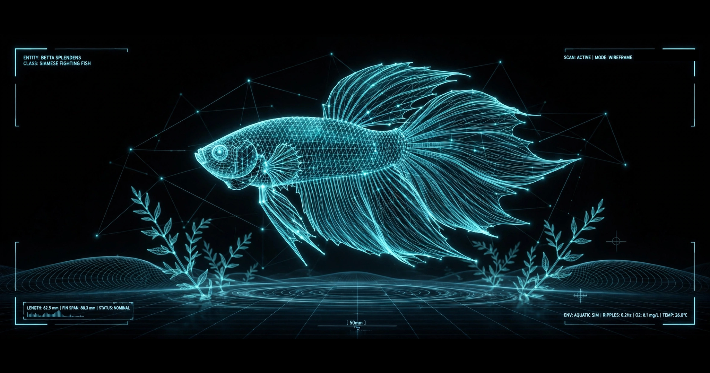
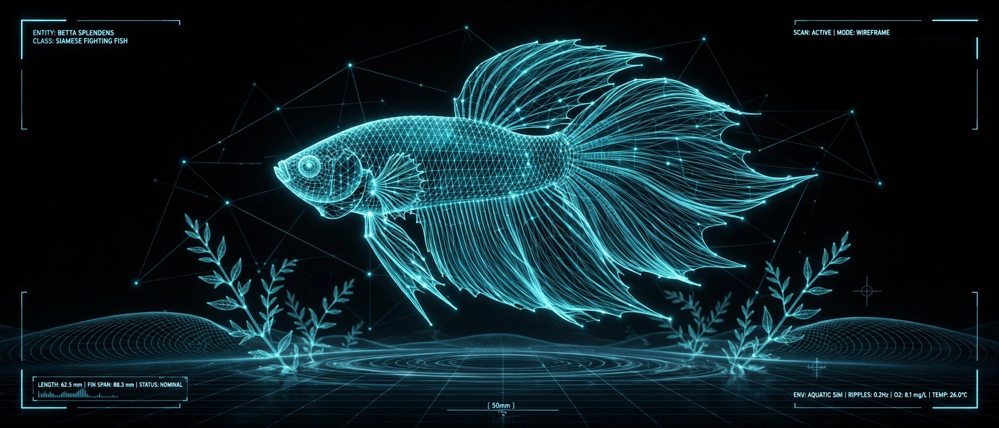

# Nova Bot (Desktop)

> *Your Discord, run from your own computer.*

Nova Bot Desktop is the same Discord bot as the Android app, running directly on a desktop or server with Node.js. Install the bundle, paste in your own bot token, and you get a bot that welcomes members, issues ID-style member cards, runs support tickets and private client areas, collects playlists, moderates, plays music in voice channels, posts news and GitHub feeds, tracks server stats, and is controlled end to end from the scripts and Discord.

Your computer stays on, the bot stays online. No phone needed.

---

## In one line

Nova Bot Desktop turns a computer into a full Discord bot host with scripts that control everything, a 320-sound soundboard to music in voice channels, and 30 plugins that stay off until you switch them on.

## What it does

| Area | What you get |
| --- | --- |
| **Members** | Welcome posts and welcome cards, join DMs, "Become a member" request → admin review → approve / deny, ID-style member cards, role picker (Designer / Developer / Maker of Things), unlock picker |
| **Community** | Leveling and XP, polls, starboard, LFG, affiliate listings, idea board, asset library, forums |
| **Support** | Tickets with private channels and transcripts, contact-us panels, private client areas with their own category, channel, forum, and handoff |
| **Voice** | Music in voice channels (`/play`, `/queue`, `/skip`, `/nowplaying`, `/volume`), a 320-sound soundboard, text-to-speech into voice channels |
| **Content** | YouTube and Suno playlists, news feeds (RSS), GitHub commit / PR / release feeds, Blues News, GIFs |
| **Moderation** | Warn, warnings, timeout, kick, ban, purge, each checks the caller's Discord permissions first |
| **Automation** | Member reminders (`/remind`), auto-posting streams, server stats updated every 10 minutes, guided setup, one-click demo server |
| **Control** | Start, stop and auto-restart scripts, terminal, diagnostics, copy-logs, the bot's guided setup inside Discord |

**37 slash commands**, grouped by who can use them, everyone, voice, personal, moderators, admins, and server owner. Everyday commands also work as text (`!ping`, `!hello`, `!time`, `!profile`, `!yt`, `!gif`).

## How it works?

Nova Bot is not one program. It is three connected parts:

1. **The desktop runtime is the scripts.** `start-bot.sh` starts the bot, `stop-bot.sh` stops it, and `ensure-nova-vm-running.sh` checks it and restarts it if it is down (run it from cron for an auto-restart check). Everything the bot shows comes from status and data files the bot itself writes, read fresh each time. It never guesses the bot's state.
2. **The bot engine is where the work happens.** A Node.js program (`bot.js`, with `voice.js`, `pacing.js`, and `traffic.js`) that runs on the computer. It holds the live connection to Discord, receives every event and joins, messages, reactions, button taps decides what each enabled plugin should do, and carries it out. It stores one configuration record per server, so two servers running the same bot can behave completely differently.
3. **Discord is where members see the result.** Channels, panels, cards, DMs, voice playback, and stats appear inside Discord, in every server the bot is invited to. There is no separate "active server" to select: joining a server makes the bot live there, with a per-server Stop / Resume switch.

### The one rule that shapes everything

The bot starts as a **blank canvas**. A fresh server gets no channels, no posts, and no automation until its owner picks a layout, generates the pieces they want, and switches each feature on. Nothing happens by accident or by default.

- Every plugin is **off by default**, and enabling one creates nothing by itself and you generate its channel and its panel post, in that order, when you are ready.
- Every auto-posting stream (welcome posts, member cards, join DMs, news, GitHub updates, activity-log lines) starts **off**. A stream that was never switched on never posts, even after a restart.
- Status **cannot lie**. ONLINE means the bot's heartbeat is fresh against the computer's own clock (under about 90 seconds old). An old heartbeat reads as DISCONNECTED with "status stale since", never as a hopeful ONLINE.

## Download

**[Download Nova Bot Desktop v1.1.0 Betta (bundle zip, 37 MB)](https://github.com/jordanalbiar/nova-bot-desktop/releases/download/v1.1.0/nova-bot-desktop-v1.1.0-betta.zip)**

First desktop update, nicknamed Betta, after the betta fish. Install it over any earlier desktop bundle. See the [v1.1.0 release notes](https://github.com/jordanalbiar/nova-bot-desktop/releases/tag/v1.1.0) for what's in it.

## Quick start

1. Download the desktop bundle zip and unzip it on your computer (Linux).
2. Install Node.js 24, ffmpeg, and Python 3 with Pillow (for card rendering).
3. Copy `.env.example` to `.env` and paste your bot token in it (file mode 0600, never shared).
4. Create your own bot application in the [Discord Developer Portal](https://discord.com/developers/applications), copy its token, and invite it to your server with Administrator.
5. Run `./start-bot.sh`.
6. Run the guided setup the bot offers in Discord, pick a layout, generate the channels and posts you want, switch on the plugins you want.

That is the whole install. No phone, no app store, no config files to edit by hand.

The bundle includes `node_modules`, so there is no `npm install` step on Linux. On another platform, delete `node_modules` and run `npm install` to rebuild it.

## Requirements

| | Minimum | Recommended |
| --- | --- | --- |
| Computer | A desktop or server that stays on | A machine that stays on 24/7 |
| Node.js | 24 | 24 |
| Runtime | ffmpeg, Python + Pillow | ffmpeg, Python + Pillow |
| Discord | Your own bot application + token | Privileged intents on: Server Members, Message Content, Presence |

One bot instance per token. The bundle never contains your token, it lives only in the bundle directory's `.env` file.

## Built with

- **Node.js 24**, the bot engine, raw Discord gateway (WebSocket) + REST, no AI tokens
- **Shell scripts**, start / stop / auto-restart check
- **Python + Pillow**, member cards, welcome cards, and profile cards, rendered per person at the moment they are needed
- **FFmpeg + yt-dlp**, music playback in voice channels
- **eSpeak NG**, text-to-speech into voice channels
- **Discord.js-style REST**, every action is an individual Discord REST request; listening is a continuous gateway stream

## The honest limits

Nova Bot is transparent about what it cannot do yet, a failed step shows as failed, never under a green checkmark.

- The bot runs on your computer, so it is only online while the computer is on. A computer that sleeps or shuts down means a dead bot until you start it again.
- Voice needs outbound UDP open to Discord. On the VM this bot was built on, outbound UDP is blocked, so joining a voice channel fails there; that is a VM limit, not a broken plugin. On a normal desktop or server with UDP open, voice join and playback work.
- The soundboard list embed shows about 150 of the 320 clips at a time; `/soundboard play` and keyword triggers work for all 320.
- Member-stats updates can hit Discord rate limits (429) on busy servers; the stats pass retries on its own schedule.
- The desktop bundle ships no dashboard UI. The bot is controlled from the start, stop and auto-restart scripts and from Discord. The web dashboard is a separate piece that runs on the machine hosting the bot.
- Linux first. The bundle is Node.js plus bash scripts, proven on Ubuntu 24.04. macOS and Windows are not claimed yet.

## Screenshots

No screenshot gallery ships with this repo yet.

## Documentation

- **What It Does & How It Works**, the full 16-page capability guide (PDF).
- **Nova Bot Breakdown Chart**, the feature breakdown (PDF).
- In Discord: Help guide and guided setup.

## Contributing

Nova Bot is built by Jordan Albiar, find him at paypal.me/jordanalbiar

---

**NOVA stands for NODE • ORIENTED • VIRTUAL • ASSISTANT**

## Current version

**Nova Bot Desktop is currently on v1.1.0 Betta**, the first desktop update, themed on the betta fish.

[Download v1.1.0 Betta (bundle zip, 37 MB)](https://github.com/jordanalbiar/nova-bot-desktop/releases/download/v1.1.0/nova-bot-desktop-v1.1.0-betta.zip) · [v1.1.0 release notes](https://github.com/jordanalbiar/nova-bot-desktop/releases/tag/v1.1.0)
